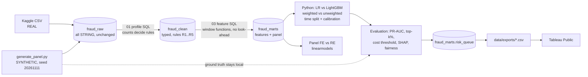

# Auto Insurance Fraud Risk: a Review Queue for a Special Investigation Unit

**Business question:** *Which claims should a hypothetical auto insurer's Special Investigation Unit (SIU) review first, given limited investigator capacity, and why?*

This repo builds a ranked fraud-risk review queue, gives a plain-English reason for every flagged claim, and checks the queue against investigator capacity, assumed costs and fairness. It runs as a reproducible pipeline: BigQuery SQL (raw → clean → features → marts), then Python modelling, then CSV exports for a Tableau Public dashboard.

> **Read this first: what the data is and isn't**
> - **Part A is real but old and anonymised.** It is the public Kaggle "Vehicle Insurance Claim Fraud Detection" table (claims from 1994–1996, CC0 licence).
> - **Part B is entirely SYNTHETIC.** It is a policyholder × month panel I generated with a fixed seed and *planted* fraud patterns in. Every Part B chart and table is labelled SYNTHETIC.
> - The results show **methods**, not real-world fraud rates. The insurer is hypothetical.
> - **A fraud score is a reason to investigate, never proof of fraud.** Decisions stay with human investigators.
> - **Every rupee figure in the cost analysis is a stated assumption** (all in [`src/config.py`](src/config.py)), not real cost data.

---

## Results at a glance

Each model was chosen on a calibration period, and all numbers below are on an untouched, later **test** period. "Top 5%" means the SIU reviews the highest-scoring 5% of claims.

| | **Part A: REAL** (test year 1996) | **Part B: SYNTHETIC** (test year 2025) |
|---|---|---|
| Test claims (fraud-labelled) | 4,083 (213) | 5,572 (489) |
| Base fraud rate | 5.2% | 8.8% |
| Model selected (on calibration period) | LightGBM, unweighted | LightGBM, unweighted |
| **PR-AUC** [95% bootstrap CI] | **0.143** [0.113, 0.181] | **0.484** [0.438, 0.537] |
| ROC-AUC (for reference only) | 0.773 | 0.837 |
| Precision / recall, top 1% | 22.0% / 4.2% | 75.0% / 8.6% |
| **Precision / recall, top 5%** | **13.2% / 12.7%** (2.5× base rate) | **67.4% / 38.4%** (7.7× base rate) |
| Precision / recall, top 10% | 13.5% / 25.8% | 47.8% / 54.4% |
| Cost rule at assumed costs: share of claims flagged, net benefit | 13.0%, **−₹2.33 lakh** | 11.8%, **+₹53.9 lakh** |

Sources: [`data/exports/kpis.csv`](data/exports/kpis.csv) and `reports/part_*/headline_metrics.json`.

**What this says, in plain English**
- **On the real data the signal is weak.** The top of the queue is about 2.5× richer in fraud than random review, but at the assumed costs a "review everything above the break-even probability" rule loses money (−₹2.33 lakh). Only the very top of the queue pays for itself: the top 0.5% (20 reviews) catches 7 frauds, for a net benefit of +₹1.52 lakh ([cost curve](reports/part_a/cost_curve_by_queue_depth.csv)). The honest recommendation is to use the real-data model for a small, high-priority list, not a broad sweep.
- **On the synthetic panel**, behavioural history makes the queue much sharper: 67% precision in the top 5%. Features such as claim timing after a coverage upgrade, repeat similar claims, and shared addresses, garages and third parties only exist when each policyholder has a history. This is the argument for collecting panel data.

---

## Pipeline



| Stage | Where | Checkpoint (test) |
|---|---|---|
| Raw load, every column as STRING | [`src/load_raw.py`](src/load_raw.py), [`reports/load_log.csv`](reports/load_log.csv) | BigQuery rows = file rows; SHA-256 of each file logged |
| Profiling → cleaning rules | `sql/part_*/01_profile_raw.sql`, `02_clean.sql`, outputs in `reports/profiling/` | Rows accounted for (clean + excluded = raw); impossible-value checks all return 0 |
| Features | `sql/part_*/03_features.sql` | One row per claim; [`tests/test_no_lookahead.py`](tests/test_no_lookahead.py) |
| Models + evaluation | [`src/part_a_model.py`](src/part_a_model.py), [`src/part_b_model.py`](src/part_b_model.py), [`src/modeling.py`](src/modeling.py) | SHAP values add up to the model output; metrics re-derived from the exported queue |
| Panel econometrics | [`src/part_b_panel.py`](src/part_b_panel.py) | Fixed-effects (FE) coefficient has the planted sign |
| Queue + exports | [`src/export.py`](src/export.py) | [`tests/test_outputs.py`](tests/test_outputs.py): ranks unique, synthetic flag correct, BigQuery = CSV |

`pytest` runs **16 tests, all passing**, including the look-ahead test against BigQuery.

---

## Data

### Part A: real claims (Kaggle, CC0)
Source: [Vehicle Insurance Claim Fraud Detection](https://www.kaggle.com/datasets/shivamb/vehicle-claim-fraud-detection), file `fraud_oracle.csv` (3,618,564 bytes; SHA-256 recorded in [`data/README.md`](data/README.md)). The licence is CC0 (public domain), so the raw file is committed.

From the profile ([`reports/profiling/part_a/`](reports/profiling/part_a)):
- **Size:** 15,420 claims, 33 columns.
- **Labels:** 923 labelled fraud (5.99%).
- **Quality:** no duplicate rows and no blank values.
- **No repeat policyholders:** `PolicyNumber` is a unique row ID (1–15,420), sorted by year, so there is no claim history per policyholder.
- **Usable time order:** 1994 has 6,142 claims (6.66% fraud), 1995 has 5,195 (5.79%) and 1996 has 4,083 (5.22%). **So Part A uses a time-based split, not stratified CV.** I had originally assumed it would need stratified CV, and the data showed otherwise.

### Part B: synthetic panel (my own generator)
[`src/generate_panel.py`](src/generate_panel.py) produces the panel; the assumptions are in [`data/synthetic/ASSUMPTIONS.md`](data/synthetic/ASSUMPTIONS.md).
- **Scale:** 20,000 policyholders, 500,841 policyholder-months (Jan 2023 – Dec 2025) and 14,296 raw claim rows.
- **Planted patterns** (counts in [`generation_summary.json`](data/synthetic/generation_summary.json)): claims soon after the policy starts or after a coverage upgrade, rising claim frequency, repeated near-identical claims, amounts just under the ₹50,000 fast-track limit, staged-accident rings that share an address, a garage and each other as third parties, plus "unpatterned" opportunistic fraud.
- **Decoys:** honest claims also fall just under the limit and soon after the policy starts.
- **Missed fraud:** only 85% of true fraud carries a historical SIU label, which lets us see whether the model finds fraud the old process missed.
- **Planted "dirt"** (duplicates, blank amounts, transposed dates, region spellings) so the cleaning step does real work.
- **Ground truth stays out of BigQuery.** The ground-truth file is never loaded there, so it cannot leak into the feature SQL. Only the evaluation code reads it.

---

## Decisions, and the data behind each

| Decision | Evidence | Source |
|---|---|---|
| **Part A uses a time split** (train 1994, calibrate 1995, test 1996) | Year column present; volumes and fraud rates by year shown above | `reports/profiling/part_a/01_profile_raw_07.csv` |
| Random CV would have **overstated** performance | Stratified 5-fold CV on 1994–95 gave PR-AUC **0.237** (±0.030); the time split on 1996 gave **0.143** | [`cv_vs_time_split.csv`](reports/part_a/cv_vs_time_split.csv) |
| **Accident month dropped** from Part A | Fraud rate is about 0% for whole blocks of months, and the block moves each year (1994 Sep–Dec, 1995 May–Aug, 1996 Jan–Mar), which looks like a labelling artefact. Dropping it raised calibration-year PR-AUC from 0.113 to 0.179. On test, 0.146 with month vs 0.143 without: within noise, and month is not a signal I would deploy. | `04_segment_checks_01.csv`, [`accident_month_ablation.csv`](reports/part_a/accident_month_ablation.csv) |
| Age = 0 treated as a placeholder, not an error | All 320 rows with Age = 0 sit in the "16 to 17" age band | `01_profile_raw_04/05.csv` |
| **Demographics are not model inputs** (age, sex, marital status, region) | Fraud targeting should not rest on who someone is. Adding demographics to Part A changes PR-AUC from 0.143 to 0.137, so nothing is gained. | [`demographic_ablation.csv`](reports/part_a/demographic_ablation.csv) |
| IDs are not features (`PolicyNumber`, `RepNumber`, `Year`) | `PolicyNumber` is a row ID sorted by year, so it encodes time and drift | profile [1], [8] |
| Class weights: compared, not assumed | They did not improve ranking (Part A test PR-AUC 0.135 weighted vs 0.143 unweighted; Part B 0.472 vs 0.484). They badly hurt calibration: Brier 0.179 vs 0.049 for Part A logistic regression | `model_comparison.csv` |
| **Calibrate before applying a cost threshold** | Platt scaling fitted on the calibration period only; reliability tables are in `calibration_test.csv` | [`a_calibration.png`](reports/figures/a_calibration.png) |
| Reproducible runs | BigQuery returns rows in no fixed order. Before sorting, Part A's PR-AUC moved between 0.134 and 0.146 from row order alone. Rows are now sorted, and two runs give byte-identical outputs | `src/part_a_model.py` `load()` |
| Part B model chosen on 2024-H2, never on test | `lgbm_unweighted` had the best calibration-period PR-AUC (0.567) | `reports/part_b/model_comparison.csv` |
| Planted fraud must match the policy's cover | An early run produced Glass claims on Basic (third-party-only) policies, a signal that would have leaked the label. Fixed in the generator; profile check [11] now returns 0 rows | `reports/profiling/part_b/01_profile_raw_11.csv` |

Data-quality rules (from counts):
- **Part A** ([`02_clean.sql`](sql/part_a/02_clean.sql)):
  - R1: Age = 0 → NULL, with the age band kept (320 rows).
  - R2: one row whose claim date is unknown is excluded.
  - R3: banded text → ordered integer codes.
  - R4: Days_Policy_Accident = "none" (55 rows) is kept as its own code, with a flag.
- **Part B** ([`02_clean.sql`](sql/part_b/02_clean.sql)):
  - R1: 57 exact duplicate rows → keep one copy.
  - R2: 26 claims with no amount → excluded.
  - R3: 18 transposed dates → swapped back and flagged.
  - R4: 13 incidents before the policy started, plus 3 before the panel window → excluded.
  - R5: 397 region spelling variants → standardised.
  - Result: 14,239 distinct rows → 14,197 clean + 42 excluded.

---

## Part B: what the behavioural features buy (SYNTHETIC)

**Feature SQL** ([`03_features.sql`](sql/part_b/03_features.sql)) uses window functions over each policyholder's history:
- claims in the previous 3, 6 and 12 months, with the frame `ROWS BETWEEN n PRECEDING AND 1 PRECEDING`
- days since the policy started, since the last coverage change and since the last upgrade
- change in claim frequency
- `LAG` of the previous claim's amount, type and shop
- the claim amount against the policyholder's own running average and standard deviation, with the frame ending at `1 PRECEDING`
- similar earlier claims
- network counts: same repair shop in the last 90 days, the same address/phone across other policyholders, and a third party who is also a customer

**No look-ahead.** The look-ahead test rebuilds every feature on data cut off at 2024-06-30 and confirms that no feature value changes for earlier claims. I also checked that the test can fail: injecting a `UNBOUNDED FOLLOWING` frame made it fail on 6,186 claims.

**Recovery of planted patterns** (test year 2025, [`pattern_recovery.csv`](reports/part_b/pattern_recovery.csv)):

| Planted pattern | In test | Caught in top 5% | Caught in top 10% |
|---|---|---|---|
| Staged-accident ring | 53 | **90.6%** | 100% |
| Claim soon after a coverage upgrade | 31 | 77.4% | 93.5% |
| Repeated near-identical claims | 57 | 73.7% | 75.4% |
| Amount just under the ₹50k limit | 114 | 60.5% | 89.5% |
| Claim soon after policy start | 32 | 59.4% | 78.1% |
| Rising claim frequency | 242 | **8.7%** | 23.6% |
| Unpatterned opportunistic fraud | 48 | 2.1% | 4.2% |
| *Planted fraud the past SIU never labelled* | 88 | 40.9% | 51.1% |

- **Rising frequency is hard to catch.** Honest high-risk customers also claim often, so frequency alone doesn't separate them, and this pattern also has more planted claims than a 5% queue has slots.
- **The model finds fraud the old process missed.** 41% of the planted fraud the historical SIU never labelled still lands in the top 5%.

**Unseen customers.** On the same 30% of policyholders, the plain time split gives PR-AUC 0.484. Holding those policyholders entirely out of training gives 0.456 ([`grouped_split_check.csv`](reports/part_b/grouped_split_check.csv)). That is a modest drop, so the model is not mostly memorising individuals.

**A caveat I put in myself.** The top global driver in Part B is `report_delay_days`. That is because my generator *assumes* fraud is reported later (mean 9 vs 5 days; see [ASSUMPTIONS.md](data/synthetic/ASSUMPTIONS.md)). The model learned an assumption I planted, which is exactly why synthetic results are not evidence about real fraud.

### Panel econometrics: fixed vs random effects (SYNTHETIC)
These are linear probability models on 500,841 policyholder-months. Coefficients are in **percentage points per month**, with standard errors clustered by policyholder. For context, the base rates are a 2.824% chance of a claim and a 0.214% chance of a fraud-labelled claim per policyholder-month ([`04_panel_summary_01.csv`](reports/profiling/part_b/04_panel_summary_01.csv)).

| "Upgraded cover in the last 2 months" → | Pooled OLS | Random effects | **Fixed effects** |
|---|---|---|---|
| Any claim this month | +2.71 | +2.51 | **+1.96** [1.12, 2.80] |
| Fraud-labelled claim this month | +2.07 | +2.19 | **+2.38** [1.88, 2.88] |

The Hausman test rejects random effects for both outcomes (χ² = 54.7, p = 3.7e-11; χ² = 139.3, p = 4.0e-29; see [`panel_fe_re.csv`](reports/part_b/panel_fe_re.csv)).

**What FE/RE says that the ML model doesn't:**
- **The ML model answers "which claim next?"; FE answers "what changes risk within a person?".** FE compares each policyholder with *themselves* over time.
- **Upgrading raises a person's own claim probability**, by about 2 points. Part of the pooled and RE effect (2.5–2.7 points) is just that riskier people upgrade more often. My generator builds that in, and FE strips it out.
- **Higher cover is not itself the cause of fraud.** On fraud, the tier effect *flips sign*: between people, Comprehensive customers have more fraud (RE +0.15 points), but moving a given customer up a tier does not raise their fraud beyond the 2-month window just after the upgrade (FE −0.23 points).
- **The practical rule:** monitor the period just after an upgrade, rather than treating Comprehensive customers as suspects.

---

## Explanations and fairness

**Per-claim reasons.** Every queued claim carries three reasons in plain English, taken from exact TreeSHAP values computed by LightGBM itself (`pred_contrib`). The code checks that the values add up to the model output, to within 1e-6.

A Part B example: *"same repair shop as previous claim (+1.54); third party is another of our policyholders (+0.89); address/phone shared with 5 other policyholders (+0.77)"*. That claim was a planted staged-ring claim.

**Flag rates by group** ([`fairness_flag_rates.csv`](reports/part_a/fairness_flag_rates.csv); no demographic field is a model input):
- **Part A (real): a proxy problem.** The model flags **43% of the "16 to 17" age band** (30 of 70 claims in 1996), even though only 1.4% of them were fraud that year. Age isn't an input. Instead, this band is a tight cluster: 99% have vehicles priced over 69k, 99% have new vehicles, 99% have no supplements and 100% are single. That cluster had **18.8% fraud in 1994**, then 1.1% in 1995 and 1.4% in 1996. A model trained on 1994 keeps "remembering" it through those proxy features ([`04_segment_checks_02/03.csv`](reports/profiling/part_a)). Retraining on 1994–95 lowers the band's flag rate to 34.3%, which still isn't enough.
  - **Recommendation:** monitor flag rates by segment, retrain on recent data, and require a human check before any action on that segment.
- **Part A, sex:** flag rates track the fraud rates (female 4.6% flagged vs 4.1% fraud; male 5.1% flagged vs 5.4% fraud).
- **Part B (synthetic):** Central region is flagged 1.5× the overall rate (7.5%), and South 0.73× (3.7%). Precision within each region is similar (0.65–0.74), so the flags are not less accurate in any one region. Small groups have wide confidence intervals, and these are reported alongside the rates.

---

## Limitations

- **Part A:**
  - The data is from the 1990s, is anonymised and is pre-binned.
  - There is no claim amount, so Part A assumes one average fraud loss of ₹60,000.
  - Labels show signs of recording artefacts (the accident-month gaps).
- **Part B is synthetic.** Its high scores reflect patterns *I* planted, at rates *I* chose.
- **The costs are assumptions:**
  - ₹5,000 per investigation
  - 60% of a fraudulent payout prevented when investigated
  - the sensitivity table in `cost_threshold_sensitivity.csv` varies these from ₹2,000 to ₹10,000 and from 40% to 80%
- **Labels are past SIU outcomes, not ground truth.** Fraud the SIU never found looks like a legitimate claim in the training data.
- **There is no feedback loop.** In production, the queue would shape future labels, because claims that are never reviewed never get labelled.

---

## Reproduce (Windows `cmd`)

```bat
py -3.14 -m venv %USERPROFILE%\.venvs\auto-fraud
%USERPROFILE%\.venvs\auto-fraud\Scripts\activate.bat
pip install -r requirements.txt
copy .env.example .env   &:: then set GCP_PROJECT
gcloud auth application-default login
run_all.bat
```

[`run_all.bat`](run_all.bat) creates the BigQuery datasets (location asia-south1), generates the synthetic panel, loads raw data, runs all SQL, trains and evaluates the models, builds the exports and runs `pytest`. The whole project scans only a few MB in BigQuery, and every query has a 1 GB `maximum_bytes_billed` cap.

## Dashboard
Tableau Public: *link added after publishing*. It is built from `data/exports/`; [`docs/DASHBOARD_GUIDE.md`](docs/DASHBOARD_GUIDE.md) gives the sheet-by-sheet build.

## Repo layout
```
data/raw/            Part A Kaggle CSV (CC0)            data/exports/   CSVs for Tableau
data/synthetic/      generator assumptions + summary (CSVs regenerated from the seed, not committed)
sql/part_a|part_b/   numbered SQL: profile -> clean -> features -> checks
src/                 load, generate, model, panel, export
tests/               16 checkpoint tests                reports/        every number quoted above
```

Data credit: Part A comes from Kaggle user *shivamb*, released under CC0. This project is not affiliated with any insurer.
